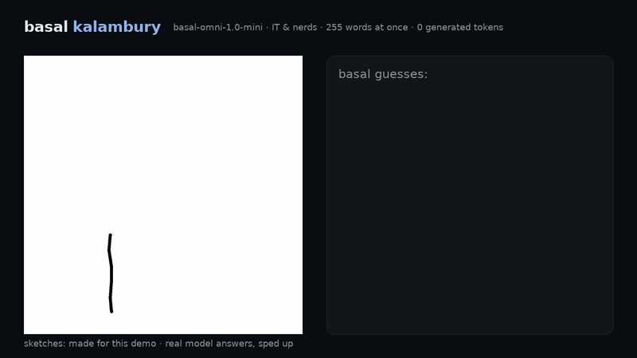
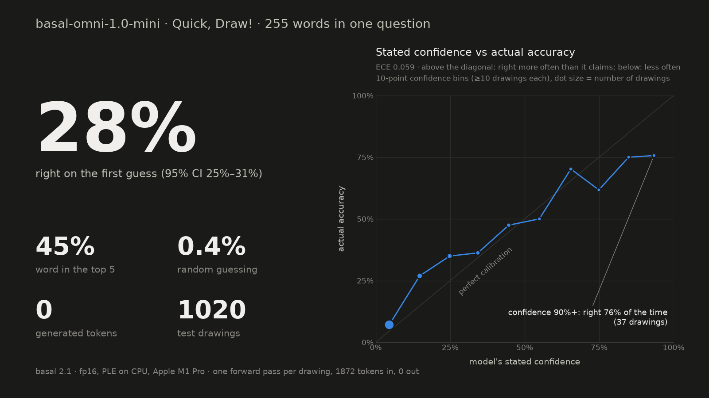
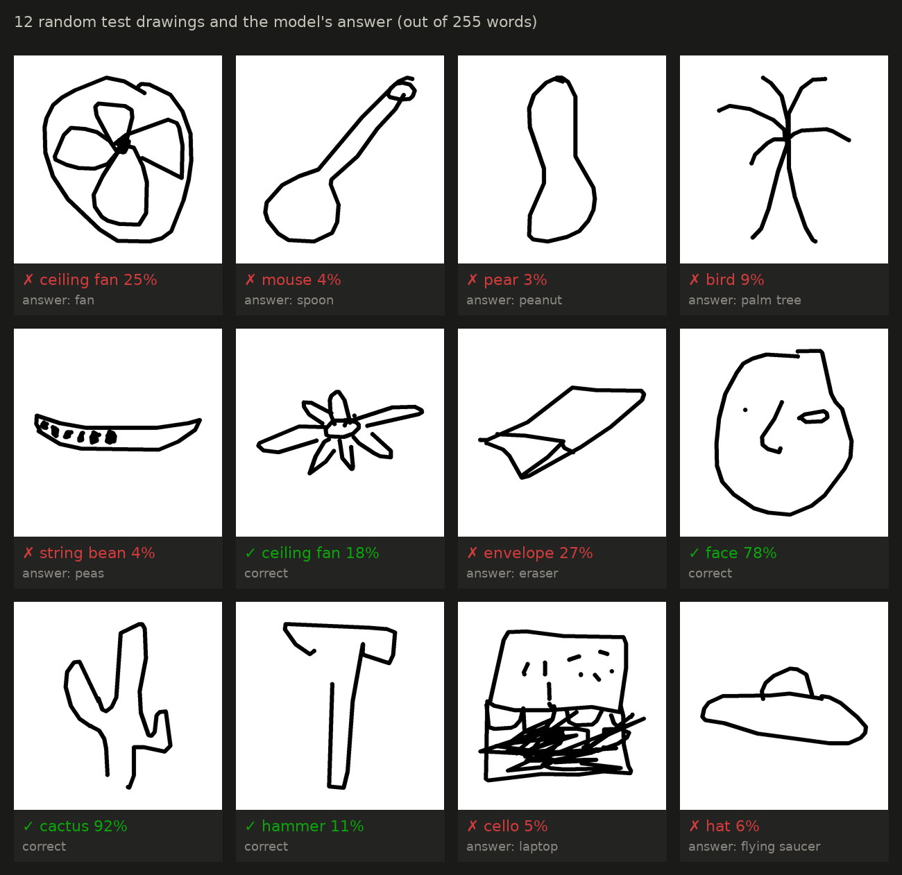
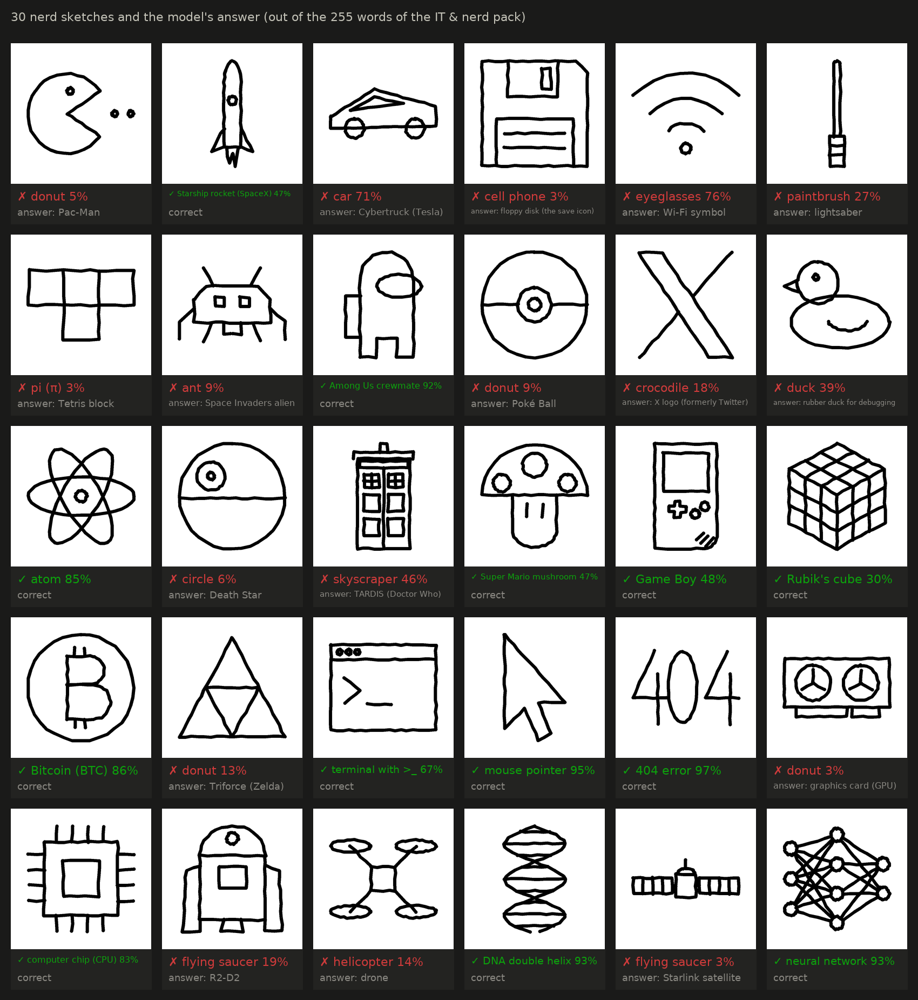
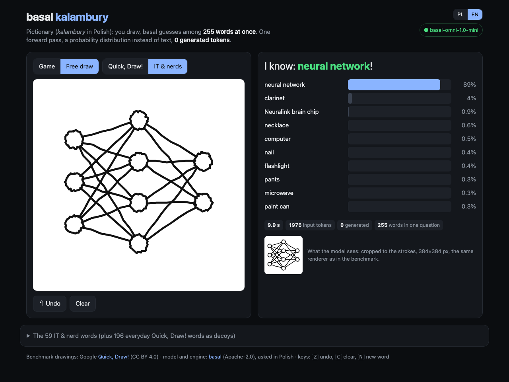

# basal kalambury

[Polski](README.pl.md) · **English**

Pictionary (*kalambury* in Polish) against a typed-decision model. You draw with the mouse and
[basal](https://github.com/rkinas/basal) guesses what it is. It weighs **255 words at once**, in **one forward pass**,
and **generates zero tokens**. Everything runs locally on a MacBook.

There are two word packs: 255 random Google Quick, Draw! categories (the benchmark) and
[IT & nerds](#the-it--nerds-pack): Starship, Cybertruck, the X logo, Pac-Man, a neural network, the TARDIS and 53 more.
The game is in English and Polish.



Full videos: [results/nerd_en.mp4](results/nerd_en.mp4) · [results/kalambury_en.mp4](results/kalambury_en.mp4) ·
results: [results/RESULTS_en.md](results/RESULTS_en.md)

## Result



The test covers 1020 Google Quick, Draw! drawings (255 words × 4). The model judged each of them against **all 255
words at once**, with no training on drawings:

| basal-omni-1.0-mini | result |
|---|---|
| right on the first guess (top-1) | **28.0%** (95% CI 25.4–30.9%) |
| word in the top 5 | **45.3%** |
| random guessing | 0.4% |
| calibration error (ECE) | 0.059 |
| generated tokens | **0** |
| median time on a MacBook Pro M1 Pro | 8.0 s |

- When the model is ≥50% sure (19% of drawings) it is right 66.5% of the time; when ≥80% sure (7%), 75%.
- Its stated confidence is off from its accuracy by 6 points on average (ECE 0.059). At low confidence it is cautious:
  in the 10–20% bin it is right 27% of the time. At the top it is overconfident: at 90%+ it is right 76% of the time.
- Its mistakes at 90%+ confidence are human: parrot → bird, barn → house, aircraft carrier → airplane,
  postcard → envelope, face → smiley face.
- It got 18 words 4 out of 4 times (bus, apple, flower, hammer, octopus, airplane and strawberry among them) and 114
  words not once.



All the tables are in [results/RESULTS_en.md](results/RESULTS_en.md), and the model's raw answers, with the full
probability distributions, in `results/test.jsonl`.

## The IT & nerds pack

The pack has 59 words: Elon Musk's world (Starship, Cybertruck, the X logo, Doge, Neuralink, Starlink…), IT (a rubber
debugging duck, a floppy disk, a terminal, a 404 error, a GPU, a neural network…) and nerd pop culture (Pac-Man, Among
Us, a lightsaber, the TARDIS, a Poké Ball…). The model still chooses among 255 options. The other 196 are everyday
Quick, Draw! words, look-alikes included on purpose: a car next to the Cybertruck, a dog next to Doge, a duck next to
the rubber duck, a bird next to the Twitter bird.

On 30 nerd sketches the model was **right 13 times on the first guess and 17 times in its top 3**. The sketches are
vector drawings made in code ([replay/nerd_sketches.py](replay/nerd_sketches.py)) with a slight hand tremor; they are
not from Quick, Draw!.

- Confident hits: 404 error (97%), mouse pointer (95%), neural network (93%), DNA double helix (93%), Among Us crewmate
  (92%), Bitcoin (86%), atom (85%), CPU chip (83%).
- Less confident hits: terminal, Game Boy, Starship, Super Mario mushroom, Rubik's cube.
- The funniest misses: Wi-Fi → eyeglasses (76%), Cybertruck → car (71%), TARDIS → skyscraper (46%),
  rubber duck → duck (39%), X logo → crocodile (18%).
- Low-confidence choices are fragile: changing one label ("bitcoin ₿" to "bitcoin (BTC)") flipped two answers that
  were below 15% confidence.



```bash
.venv/bin/python replay/nerd_sketches.py    # results/nerd.jsonl + galleries in Polish and English
```

## How it works

basal is not a chatbot. It does not write an answer: it reads a "state" and returns a probability distribution over
the options you send in the request. Here the state is the image of the drawing, and the `choice` question has 255
options. That is basal's maximum: every option gets its own code, and in one forward pass the model reads the logits of
all the codes at once.

```json
{
  "state": "Odręczny szkic narysowany myszką w grze w kalambury: czarne kreski na białym tle.",
  "media": [{"type": "image", "data": "<PNG as base64>"}],
  "questions": {"haslo": {"type": "choice", "instructions": "Co przedstawia ten rysunek?",
                          "criteria": {"airplane": "samolot", "alarm clock": "budzik", "…": "…255 words"},
                          "option_keys": "hide"}},
  "lang": "pl"
}
```

The model is asked in Polish (basal is a Polish–English model): "A hand-drawn sketch made with a mouse in a game of
charades: black lines on a white background. What does this drawing show?" The answer holds the chosen word, its
confidence and the probabilities of all 255 words; `usage.output_tokens` is 0.

1. The strokes become a 384×384 image cropped to the drawing ([kalambury/render.py](kalambury/render.py)). The same
   code serves the game, the benchmark and the videos, so the model always sees the same thing.
2. `basal-serve` with a basal-omni model (Gemma 4 fine-tuned on decisions) reads the image with Gemma 4's vision
   encoder. basal-omni was trained on text decisions only, so recognising sketches is pure zero-shot.
3. The game asks the model after every stroke and shows the 10 most likely words live
   ([kalambury/static/app.js](kalambury/static/app.js)).

## Running it



In the game you switch the language (PL/EN) and the word pack (Quick, Draw! or IT & nerds). The choice goes into the
address, e.g. `http://127.0.0.1:7860/?lang=en&pack=nerd`. The model always gets the question and the words in Polish,
as in the benchmark; the English version only changes what people see.

You need Python 3.11+ and ~16 GB of memory for basal-omni-1.0-mini. On a Mac, thanks to the fix below, that is ~10 GB
of GPU memory and ~6 GB of RAM. The weights take ~16 GB of disk.

```bash
git clone https://github.com/szerment84/basal-kalambury && cd basal-kalambury
python3 -m venv .venv && .venv/bin/pip install -r requirements.txt
./start.sh        # basal-serve on :8000 + the game at http://127.0.0.1:7860
```

The game works with any basal-omni model:
- `BASAL_MODEL=Remek/basal-omni-1.0-ultra ./start.sh`: 31B, images but no audio, needs an 80 GB GPU;
- `Remek/basal-omni-1.1-max` or `Remek/basal-omni-1.0-max`: 12B, ~24 GB.

On NVIDIA you can also run plain `basal-serve --model Remek/basal-omni-1.0-mini --mode eager --media on --port 8000`
and then `python -m kalambury.server`.

## An Apple Silicon trick: 5.6 GB that do not need to sit on the GPU

basal-omni-1.0-mini is Gemma 4 E4B: 7.9B parameters, 2.8B of them in the per-layer embedding table
(`embed_tokens_per_layer`, 5.6 GB in fp16). Each request reads only the rows of its ~1900 tokens, but MPS pins the
whole buffer to the GPU on every forward pass. [kalambury/serve.py](kalambury/serve.py) is `basal-serve` with one change:
the table stays in CPU RAM and only the rows that were read go to the GPU.

| MacBook Pro M1 Pro, 32 GB (memory under heavy pressure), 255 options | GPU memory | median time per guess |
|---|---|---|
| `basal-serve`, bf16 (the official path) | 15.9 GB | 14.4 s |
| `kalambury.serve`, fp16 + per-layer embeddings on the CPU | 10.3 GB | 8.1 s |

The logits with the table on the CPU and on the GPU are identical (a difference of 0.0), since it only copies rows. I
use fp16 instead of bf16 because M1/M2 GPUs have no native bf16: a matmul runs at 1.9 TFLOPS in bf16 against
3.9 TFLOPS in fp16. On 24 control drawings from `data/quickdraw_dev.jsonl` this setup chose the same word as bf16 in
24 of 24 cases, with confidence differing by at most 0.04.

## The benchmark (reproducible)

```bash
python bench/fetch_quickdraw.py                                               # data/: 255 dev + 1020 test
.venv/bin/python bench/run.py data/quickdraw_test.jsonl results/test.jsonl    # can be stopped and resumed
.venv/bin/python bench/report.py results/test.jsonl                           # RESULTS*.md + charts (PL and EN)
```

- **Words:** 255 random categories out of Google Quick, Draw!'s 345 (seed 2026 in
  [kalambury/words.py](kalambury/words.py)), not hand-picked. Bicycle, sun and pizza are among those left out.
- **Drawings:** 4 per word from random chunks of the `simplified` files, only `recognized=true` ones (recognised in the
  original game). Without that filter the set is full of unfinished scribbles.
- **No tuning:** one prompt and the Polish word names, fixed before the test. The dev set was used only to check the
  engine (bf16 vs fp16).
- **Calibration:** built into the model (`CALIBRATION.json`, temperatures fitted on text decisions). ECE uses 10 equal
  confidence bins.

The videos come from [replay/make_video.py](replay/make_video.py) (`--lang pl|en`, `--pack quickdraw|nerd`). It replays
the drawings stroke by stroke and asks the model after every stroke. The answers are real; only the pace is sped up.

## Limitations

- The image is read by Gemma 4's encoder without extra training, so the calibration comes from text too
  (`"calibration": "text"` in the server's answer).
- On an M1 Pro one guess takes a few seconds. The prompt has ~1870 tokens, ~1500 of them the list of 255 words. On an
  NVIDIA GPU it takes a fraction of a second.
- Quick, Draw! words can be ambiguous (mug / cup / coffee cup, mouse, swing set / see saw).
- **"Mouse" as an attractor.** The request's state says "a sketch drawn with a mouse", and the model picked "mouse" for
  116 of the 1020 drawings (correctly 4 times), almost always at low confidence (median 5%). Removing that pull would
  raise top-1 by at most 0.4 points (from 28.0% to 28.4%), so the prompt stayed as it was and the game and the
  benchmark use the same one.

## Licences and thanks

The code is MIT. The drawings come from Google [Quick, Draw!](https://quickdraw.withgoogle.com/data) (CC BY 4.0).
The [basal](https://github.com/rkinas/basal) engine and models (Apache-2.0, models based on Gemma 4) are by
[@KinasRemek](https://x.com/KinasRemek). The idea came from the basal test on Matejko's "Battle of Grunwald" by
[@KobyleckiMarcin](https://x.com/KobyleckiMarcin).
