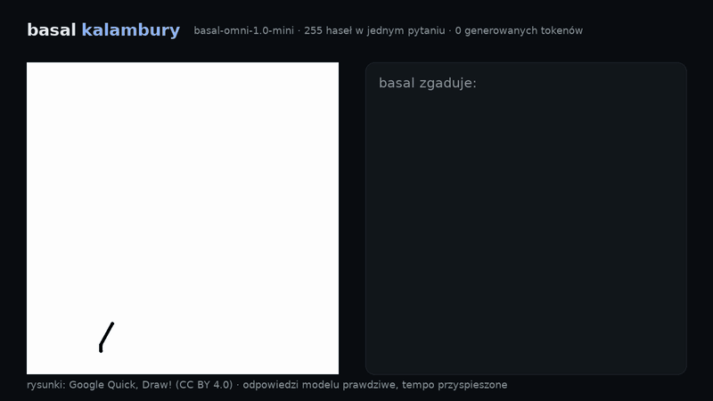
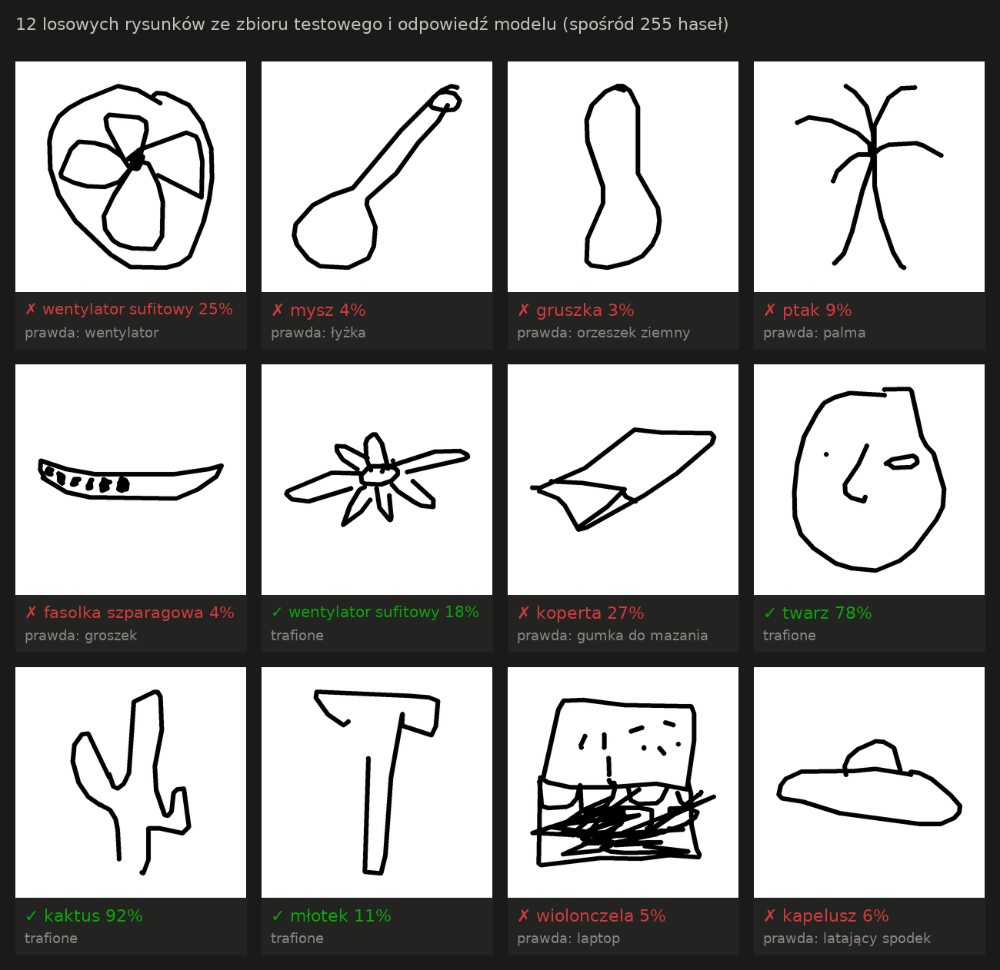

# basal kalambury

Rysujesz myszką, a [basal](https://github.com/rkinas/basal) zgaduje, co to jest. Wybiera spośród **255 haseł naraz**,
w **jednym przebiegu** modelu i **bez generowania ani jednego tokena**. Wszystko działa lokalnie, na MacBooku.



Pełne wideo: [results/kalambury.mp4](results/kalambury.mp4) · wyniki: [results/RESULTS.md](results/RESULTS.md)

## Wynik


Test objął 1020 rysunków z Google Quick, Draw! (255 haseł × 4). Model oceniał każdy z nich spośród **wszystkich 255
haseł naraz**, bez żadnego treningu na rysunkach:

| basal-omni-1.0-mini | wynik |
|---|---|
| trafienie za pierwszym razem (top-1) | **28,0%** (95% CI 25,4–30,9%) |
| hasło w pierwszej piątce (top-5) | **45,3%** |
| losowe zgadywanie | 0,4% |
| błąd kalibracji (ECE) | 0,059 |
| wygenerowane tokeny | **0** |
| mediana czasu na MacBooku Pro M1 Pro | 8,0 s |

- Przy pewności ≥50% (19% rysunków) model trafia w 66,5%, a przy ≥80% (7% rysunków) w 75%.
- Deklarowana pewność mija się z trafnością średnio o 6 pp. (ECE 0,059). Przy niskiej pewności model jest ostrożny:
  w przedziale 10–20% trafia w 27%. W najwyższym przedziale jest zbyt pewny siebie: przy 90%+ trafia w 76%.
- Pomyłki przy pewności 90%+ są „ludzkie”: papuga → ptak, stodoła → dom, lotniskowiec → samolot,
  pocztówka → koperta, twarz → uśmiechnięta buźka.
- 18 haseł model zgadł 4 razy na 4 (m.in. autobus, jabłko, kwiat, młotek, ośmiornica, samolot, truskawka), a 114
  haseł ani razu.



Wszystkie tabele są w [results/RESULTS.md](results/RESULTS.md), a surowe odpowiedzi modelu, z rozkładami
prawdopodobieństwa, w `results/test.jsonl`.

## Jak to działa

basal to nie chatbot. Nie pisze odpowiedzi, tylko czyta „stan” i zwraca rozkład prawdopodobieństwa nad opcjami, które
podajesz w zapytaniu. Tu stanem jest obraz rysunku, a pytanie typu `choice` ma 255 opcji. To maksimum API basal: każda
opcja dostaje swój kod, a model w jednym przebiegu czyta logity wszystkich kodów naraz.

```json
{
  "state": "Odręczny szkic narysowany myszką w grze w kalambury: czarne kreski na białym tle.",
  "media": [{"type": "image", "data": "<PNG w base64>"}],
  "questions": {"haslo": {"type": "choice", "instructions": "Co przedstawia ten rysunek?",
                          "criteria": {"airplane": "samolot", "alarm clock": "budzik", "…": "…255 haseł"},
                          "option_keys": "hide"}},
  "lang": "pl"
}
```

W odpowiedzi przychodzi wybrane hasło, pewność i prawdopodobieństwa wszystkich 255 haseł. Pole
`usage.output_tokens` wynosi 0.

1. Kreski zamieniają się w obraz 384×384 przycięty do rysunku ([kalambury/render.py](kalambury/render.py)). Ten sam
   kod obsługuje grę, benchmark i wideo, więc model zawsze widzi to samo.
2. `basal-serve` z modelem basal-omni (Gemma 4 dotrenowana na decyzjach) czyta obraz enkoderem wizji Gemma 4.
   basal-omni był trenowany wyłącznie na decyzjach tekstowych, więc rozpoznawanie szkiców to czysty zero-shot.
3. Gra pyta model po każdej kresce i na żywo pokazuje 10 najbardziej prawdopodobnych haseł
   ([kalambury/static/app.js](kalambury/static/app.js)).

## Uruchomienie

Potrzebujesz Pythona 3.11+ i ~16 GB pamięci na basal-omni-1.0-mini. Na Macu dzięki poprawce niżej to ~10 GB GPU i ~6 GB
RAM. Wagi zajmują ~16 GB na dysku.

```bash
git clone https://github.com/szerment84/basal-kalambury && cd basal-kalambury
python3 -m venv .venv && .venv/bin/pip install -r requirements.txt
./start.sh        # basal-serve na :8000 + gra na http://127.0.0.1:7860
```

Gra działa z każdym modelem basal-omni:
- `BASAL_MODEL=Remek/basal-omni-1.0-ultra ./start.sh`: 31B, obraz bez audio, wymaga GPU z 80 GB;
- `Remek/basal-omni-1.1-max` albo `Remek/basal-omni-1.0-max`: 12B, ~24 GB.

Na NVIDIA możesz też uruchomić zwykły `basal-serve --model Remek/basal-omni-1.0-mini --mode eager --media on --port 8000`,
a potem `python -m kalambury.server`.

## Trik na Apple Silicon: 5,6 GB, które nie muszą siedzieć na GPU

basal-omni-1.0-mini to Gemma 4 E4B: 7,9 mld parametrów, z czego 2,8 mld to tabela per-layer embeddings
(`embed_tokens_per_layer`, 5,6 GB w fp16). Każde zapytanie czyta z niej tylko wiersze swoich ~1900 tokenów, ale MPS
przy każdym przebiegu przypina do GPU cały bufor. [kalambury/serve.py](kalambury/serve.py) to `basal-serve` z jedną
zmianą: ta tabela zostaje w RAM-ie CPU, a na GPU trafiają tylko odczytane wiersze.

| MacBook Pro M1 Pro, 32 GB (mocno zajęta pamięć), 255 opcji | pamięć GPU | mediana czasu zgadywania |
|---|---|---|
| `basal-serve`, bf16 (oficjalna ścieżka) | 15,9 GB | 14,4 s |
| `kalambury.serve`, fp16 + per-layer embeddings na CPU | 10,3 GB | 8,1 s |

Logity z tabelą na CPU i na GPU są identyczne (różnica 0,0), bo to zwykła kopia wierszy. Używam fp16 zamiast bf16, bo GPU
M1/M2 nie liczy natywnie w bf16: matmul osiąga 1,9 TFLOPS w bf16 wobec 3,9 TFLOPS w fp16. Na 24 rysunkach kontrolnych
z `data/quickdraw_dev.jsonl` ta konfiguracja wybrała to samo hasło co bf16 w 24/24 przypadkach. Pewność różniła się
najwyżej o 0,04.

## Benchmark (do powtórzenia)

```bash
python bench/fetch_quickdraw.py                                               # data/: 255 dev + 1020 test
.venv/bin/python bench/run.py data/quickdraw_test.jsonl results/test.jsonl    # można przerwać i wznowić
.venv/bin/python bench/report.py results/test.jsonl                           # RESULTS.md + wykresy
```

- **Hasła:** 255 losowych z 345 kategorii Google Quick, Draw! (seed 2026 w
  [kalambury/words.py](kalambury/words.py)), a nie wybranych ręcznie. Wypadły m.in. rower, słońce i pizza.
- **Rysunki:** po 4 na hasło z losowych fragmentów plików `simplified`, tylko `recognized=true`, czyli rozpoznane
  w oryginalnej grze. Bez tego filtra zbiór zawiera dużo niedokończonych bazgrołów.
- **Bez strojenia:** jeden prompt i polskie nazwy haseł ustaliłem przed testem. Zbiór dev posłużył tylko do sprawdzenia
  silnika (bf16 vs fp16).
- **Kalibracja:** wbudowana w model (`CALIBRATION.json`, temperatury z decyzji tekstowych). ECE liczę na 10 równych
  przedziałach pewności.

Wideo generuje [replay/make_video.py](replay/make_video.py). Odtwarza rysunki kreska po kresce i po każdej kresce pyta
model. Odpowiedzi są prawdziwe, tylko tempo jest przyspieszone.

## Ograniczenia

- Obraz czyta enkoder Gemma 4 bez dodatkowego treningu, więc kalibracja też pochodzi z tekstu
  (`"calibration": "text"` w odpowiedzi serwera).
- Na M1 Pro jedno zgadywanie trwa kilka sekund. Prompt ma ~1870 tokenów, z czego ~1500 to lista 255 haseł.
  Na GPU NVIDIA to ułamki sekundy.
- Hasła Quick, Draw! bywają dwuznaczne (kubek / kubeczek / filiżanka kawy, mysz, huśtawka / huśtawka wagowa).
- **„Mysz” jako atraktor.** Stan zapytania mówi „szkic narysowany myszką”, a model wybrał „mysz” w 116 z 1020
  rysunków (trafnie 4 razy), prawie zawsze przy niskiej pewności (mediana 5%). Usunięcie tej preferencji podniosłoby
  top-1 najwyżej o 0,4 pp. (z 28,0% do 28,4%). Zostawiłem więc prompt bez zmian, żeby gra i benchmark używały tego
  samego.

## Licencje i podziękowania

Kod jest na licencji MIT. Rysunki pochodzą z Google [Quick, Draw!](https://quickdraw.withgoogle.com/data) (CC BY 4.0).
Silnik i modele [basal](https://github.com/rkinas/basal) (Apache-2.0, modele na bazie Gemma 4) stworzył
[@KinasRemek](https://x.com/KinasRemek). Inspiracją był test basala na „Bitwie pod Grunwaldem”
[@KobyleckiMarcin](https://x.com/KobyleckiMarcin).
